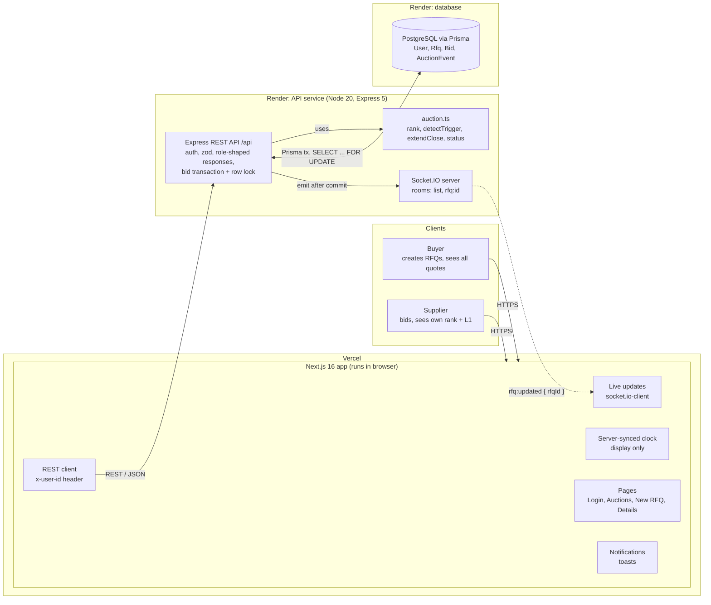

# Architecture Diagram Prompt

A self-contained description of the system, written to be pasted into a diagramming tool (Eraser.io DiagramGPT, Excalidraw AI, Lucidchart AI, Whimsical, Napkin, draw.io AI, ChatGPT/Claude with image or Mermaid output).

- **Section 1** is the ready-to-paste prompt.
- **Section 2** is the exact component and connection list, for tools that want structured input or if you want to draw it by hand.
- **Section 3** is Mermaid code that renders directly in GitHub, mermaid.live, Notion or draw.io (Arrange > Insert > Advanced > Mermaid).

A finished version drawn from this spec is in [`architecture.png`](architecture.png) / [`architecture.svg`](architecture.svg).

---

## 1. Paste-ready prompt

> Draw a clean, professional high-level architecture diagram for a **"British Auction RFQ System"**: a web app where a buyer creates a freight Request for Quotation (RFQ) and suppliers compete in a live reverse auction by lowering their prices. Bids near the end automatically extend the auction, and a forced close time caps it.
>
> **Layout:** left to right, four labelled zones, with a numbered flow strip below them.
>
> **Zone 1, "Clients":** two actor boxes.
> - "Buyer": creates RFQs, sets the trigger window X, extension Y and trigger type, and sees every quote ranked L1, L2, L3.
> - "Supplier": submits and lowers quotes, and sees only their own rank and the lowest price.
>
> **Zone 2, "Vercel":** one box, "Next.js 16 app (React 19, Tailwind, runs in the browser)", with five stacked sub-boxes:
> - Pages: Login, Auctions list, New RFQ, Auction details
> - REST client: fetch with an x-user-id header
> - Server-synced clock: offset from serverNow, display only
> - Live updates: socket.io-client, rooms "list" and "rfq:id"
> - Notifications: toasts for outbid, new bids and extensions
>
> **Zone 3, "Render: API service (Node 20, Express 5, TypeScript)":** three boxes.
> - "Express REST API /api" (emphasized, dark fill): mock auth via x-user-id, zod validation, role-shaped responses (buyer vs supplier), bid transaction under a per-RFQ row lock.
> - "auction.ts pure domain rules": rank(), detectTrigger(), extendClose(), status(); no DB, no clock, unit-tested.
> - "Socket.IO server": rooms "list" and "rfq:<id>"; broadcasts carry only { rfqId }.
>
> **Zone 4, "Render: database":** a PostgreSQL cylinder (Prisma ORM) listing four tables:
> - User (buyer or supplier)
> - Rfq (times, X, Y, trigger type; the row-lock target)
> - Bid (append-only quotes)
> - AuctionEvent (append-only activity log)
>
> **Arrows:**
> 1. Buyer → Next.js app, labelled "HTTPS".
> 2. Supplier → Next.js app, labelled "HTTPS".
> 3. Next.js app → Express REST API, labelled "REST / JSON: GET data, POST bids".
> 4. Express REST API → auction.ts, labelled "uses".
> 5. Express REST API ↔ PostgreSQL, double-headed, labelled "Prisma transaction, SELECT ... FOR UPDATE".
> 6. Express REST API → Socket.IO server, labelled "emit after commit".
> 7. Socket.IO server → Next.js app, **dashed**, labelled "WebSocket: rfq:updated { rfqId }".
>
> **Below the zones**, a horizontal strip titled "Bid placement (critical path)" with 7 numbered steps connected by arrows:
> 1. Submit bid (POST /rfqs/:id/bids, timestamped on arrival)
> 2. Lock auction (BEGIN; SELECT Rfq FOR UPDATE)
> 3. Validate (start ≤ now < current close; lower than the supplier's own last bid)
> 4. Record (INSERT Bid and a BID_PLACED event)
> 5. Check trigger (re-rank; is it in the last X minutes and did rule a/b/c fire?)
> 6. Extend (close = min(close + Y, forced close); log the reason)
> 7. Commit and notify (emit rfq:updated; clients refetch and show a toast)
>
> **Optional footer**, four small cards titled "Guarantees":
> - "Forced close is a hard cap"
> - "Server clock decides (UI timer is display-only)"
> - "Bids serialized per auction (row lock)"
> - "No data in broadcasts (clients refetch with their own role)"
>
> **Style:** light background, white boxes with thin black outlines, black text, one dark-filled emphasis box (the REST API), rounded corners, a sans-serif font, no gradients, no 3D, no clip-art. Label every arrow.

---

## 2. Structured spec

### Groups and nodes

| Group | Node id | Label | Details |
|---|---|---|---|
| Clients | `buyer` | Buyer | Creates RFQs, configures X / Y / trigger, sees all quotes ranked |
| Clients | `supplier` | Supplier | Submits and lowers quotes, sees own rank + L1 price only |
| Vercel | `web` | Next.js 16 app | React 19, Tailwind v4, client-rendered pages |
| Vercel (inside `web`) | `pages` | Pages | Login, Auctions list, New RFQ, Auction details |
| Vercel (inside `web`) | `client` | REST client | fetch + `x-user-id` header |
| Vercel (inside `web`) | `clock` | Server-synced clock | `offset = serverNow - request midpoint`; countdown is display only |
| Vercel (inside `web`) | `live` | Live updates | socket.io-client; joins `list` and `rfq:<id>` |
| Vercel (inside `web`) | `toasts` | Notifications | Sonner toasts: outbid, new bids, extensions, bid placed, closed |
| Render: API | `api` | Express REST API `/api` | Mock auth, zod validation, role-shaped responses, bid transaction |
| Render: API | `domain` | auction.ts | Pure functions: `rank`, `detectTrigger`, `extendClose`, `status` |
| Render: API | `ws` | Socket.IO server | Rooms `list`, `rfq:<id>`; payload `{ rfqId }` only |
| Render: DB | `db` | PostgreSQL (Prisma) | Tables below |
| Render: DB (inside `db`) | `t_user` | User | id, name, company, role |
| Render: DB (inside `db`) | `t_rfq` | Rfq | refId, bidStartAt, bidCloseAt, currentCloseAt, forcedCloseAt, pickupDate, triggerWindowMin (X), extensionMin (Y), triggerType |
| Render: DB (inside `db`) | `t_bid` | Bid | carrierName, freight/origin/destination charges, totalAmount, transitTimeDays, quoteValidUntil |
| Render: DB (inside `db`) | `t_event` | AuctionEvent | type (BID_PLACED, TIME_EXTENDED, EXTENSION_CAPPED), oldCloseAt, newCloseAt, reason |

### Edges

| From | To | Style | Label |
|---|---|---|---|
| `buyer` | `web` | solid | HTTPS |
| `supplier` | `web` | solid | HTTPS |
| `web` | `api` | solid | REST / JSON (GET data, POST bids) |
| `api` | `domain` | solid | uses |
| `api` | `db` | solid, both directions | Prisma transaction, `SELECT ... FOR UPDATE` |
| `api` | `ws` | solid | emit after commit |
| `ws` | `web` | dashed | WebSocket: `rfq:updated { rfqId }` |

### REST endpoints (optional annotation on the `api` node)

`GET /health` · `GET /users` · `GET /rfqs` · `POST /rfqs` (buyer) · `GET /rfqs/:id` · `POST /rfqs/:id/bids` (supplier)

---

## 3. Mermaid



```mermaid
sequenceDiagram
    autonumber
    participant S as Supplier browser
    participant API as Express API
    participant DB as PostgreSQL
    participant IO as Socket.IO
    participant O as Other browsers
    S->>API: POST /api/rfqs/:id/bids
    API->>DB: BEGIN; SELECT Rfq FOR UPDATE
    API->>DB: load bids, rank before
    Note over API: validate window and bid < own last bid
    API->>DB: INSERT Bid + BID_PLACED
    Note over API: rank after; in last X min and trigger fired?
    API->>DB: UPDATE currentCloseAt = min(close + Y, forced); INSERT TIME_EXTENDED
    API->>DB: COMMIT
    API->>IO: emit rfq:updated { rfqId }
    API-->>S: 201 + updated auction
    IO-->>O: rfq:updated { rfqId }
    O->>API: GET /api/rfqs/:id (own role)
```
