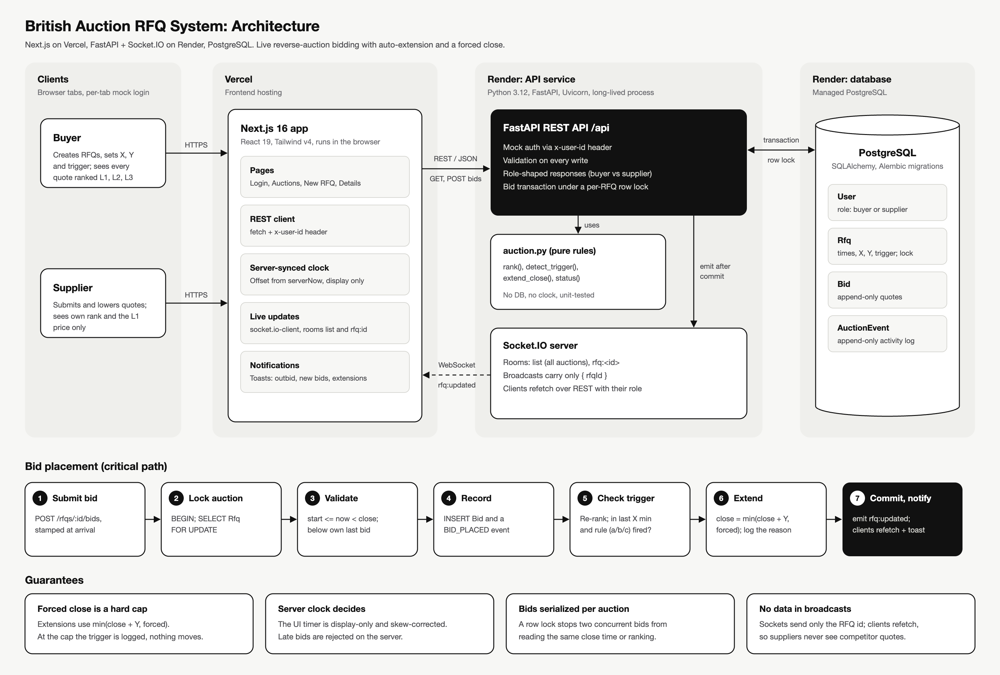
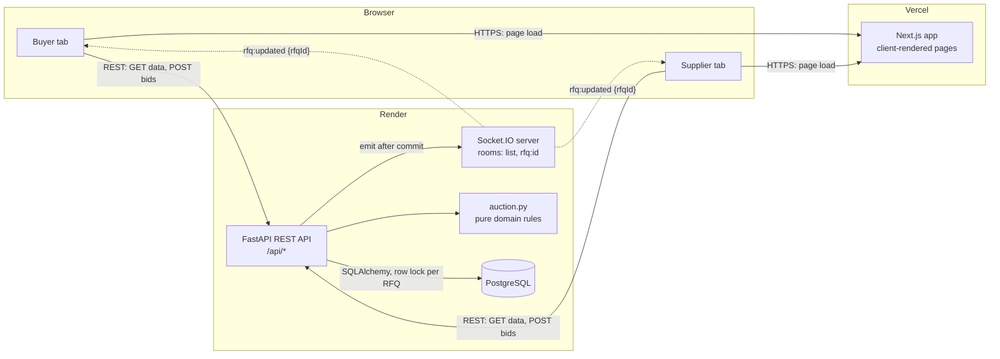
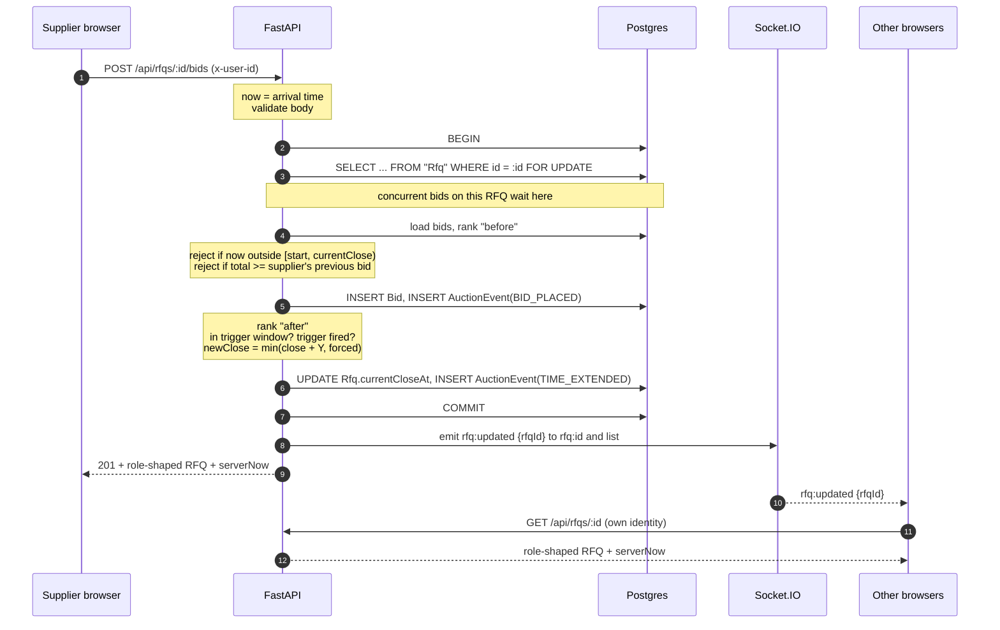

# High-Level Design: British Auction RFQ System

## 1. Architecture

Source: [`architecture.svg`](architecture.svg). For a diagram of the backend internals (FastAPI request pipeline, modules, data access, deploy), use [`BACKEND_ARCHITECTURE_PROMPT.md`](BACKEND_ARCHITECTURE_PROMPT.md).

| Component | Responsibility |
|---|---|
| **Next.js (Vercel)** | UI only. Pages are client components that call the API, keep a server-synced clock and listen on Socket.IO. |
| **FastAPI API (Render)** | Validation, mock auth, role-shaped responses and the bid transaction. The only thing that decides whether a bid counts. Runs on Uvicorn with python-socketio mounted alongside. |
| **`auction.py`** | Pure functions: ranking, trigger detection, extension math, status. No DB and no clock, so they are unit-tested in isolation. |
| **Socket.IO** | Push channel. Broadcasts carry **only the RFQ id**. Clients refetch over REST with their own identity, so a supplier can never receive competitor data through a broadcast. |
| **PostgreSQL** | Source of truth. One row lock per RFQ serializes bids. |

Why Render for the API: Vercel functions are serverless and can't hold a WebSocket open. Render runs a long-lived Python (Uvicorn) process.

## 2. Bid placement (the critical path)

## 3. Auction rules

| Rule | Implementation |
|---|---|
| Bid window | `bidStartAt <= now < currentCloseAt`. A bid exactly at close is late. |
| Trigger window | `currentCloseAt - X <= now < currentCloseAt`. Measured from the **current** close, so it moves with every extension. |
| Extension | `newClose = min(currentCloseAt + Y, forcedCloseAt)`, matching the spec example (6:00 PM becomes 6:05 PM). |
| Forced close | Never exceeded. If the close is already at the cap, the trigger is logged as `EXTENSION_CAPPED` and nothing moves. |
| Ranking | Each supplier's latest bid (also their lowest, see below), sorted by total. A tie goes to whoever bid that price first. |
| Bid improvement | A supplier's new bid must be lower than their own previous bid. They can sit at any rank, which keeps L1/L2/L3 meaningful. |
| Status | Derived from timestamps on every read, never stored: Upcoming, Active, Closed (ended at a normal close), Force Closed (`currentCloseAt == forcedCloseAt`). No cron, and nothing is lost on restart. |

### Trigger types

| Trigger | Fires when | Does not fire when |
|---|---|---|
| `BID_RECEIVED` | Any accepted bid inside the window | (always fires in window) |
| `ANY_RANK_CHANGE` | A previously ranked supplier's rank changes (overtake, or a newcomer lands above someone) | A newcomer enters at the bottom; L1 lowers their own price; the very first bid |
| `L1_CHANGE` | The lowest bidder becomes a different supplier | L1 lowers their own price; the very first bid (no previous L1) |

The three only behave differently because a bid doesn't have to beat L1. If every bid had to beat L1, all three would fire on almost every bid.

## 4. Integrity of the timer

The countdown is shown to everyone, because suppliers need to see extensions to react to them. It is **display-only**:

1. **The server clock decides.** Every bid is checked against server time inside the transaction. A bid sent from a laggy browser showing "0:01 left" is rejected if the server says the auction has closed.
2. **Clock-skew correction.** Every API response includes `serverNow`. The client stores `offset = serverNow - midpoint(request sent, response received)` and ticks the countdown from `Date.now() + offset`. Changing the computer's clock has no effect.
3. **Arrival-time stamping.** The bid's timestamp is taken when the request arrives, before waiting for the lock. Close times only ever move later, so this never lets a late bid in, and a bid that arrived on time isn't penalized for queueing behind another bid.
4. **Serialization.** `SELECT ... FOR UPDATE` on the RFQ row means two simultaneous bids can't both read the old close time or the old ranking.
5. **Self-healing UI.** When a countdown hits zero, the client refetches. On a socket reconnect, it rejoins its room and refetches in case it missed broadcasts.

## 5. Notifications

Toasts are built on Sonner (headless: Sonner handles stacking, swipe and timers; the card design is ours, in `lib/notify.tsx`). They come from two places:

| Source | Scope | Toasts |
|---|---|---|
| `LiveNotifications` (mounted once in the layout, listens on `list`) | Every auction except the one on screen | Buyer: new bid (with extension if any). Supplier: "You've been outbid on RFQ-x", extension of an auction you bid in, new RFQ open for bids. |
| Auction details page (listens on `rfq:<id>`) | The auction on screen | New activity-log entries since the last fetch: new bid, outbid (rank got worse), extension with its reason, forced cap reached; plus "bidding is open" / "auction closed" when the countdown crosses a boundary; and "bid placed" for your own bid. |

Both work by diffing fresh REST data against what the client saw last, so they inherit the same role-based visibility as the pages. Toast ids are per auction, so a burst of bids updates one toast instead of stacking many. The listing response includes each supplier's own rank (`myRank`) so outbids can be detected without opening the auction.

## 6. Visibility (who sees what)

| Data | Buyer | Supplier |
|---|---|---|
| Auction config, times, status, L1 price | Yes | Yes |
| All suppliers' quotes, names, ranks | Yes | No |
| Own quotes and own rank | n/a | Yes |
| Activity log | Full, with names | Own bids in full. Competitor bids appear as "A competitor placed a bid". Extensions show the trigger type only. |

Shaping happens in one place (`details()` in `backend-py/app/routes.py`), and broadcasts carry no data, so there's no second path that could leak.

## 7. Assumptions and edge-case decisions

- **Auth is mocked**: you pick a seeded user and the client sends `x-user-id`. Real auth (sessions or JWT) would replace one FastAPI dependency.
- **Currency is INR**. Charges are stored as `Decimal(12,2)` and compared as integer paise to avoid float drift.
- **Total price** = freight + origin + destination charges. Ranking uses the total.
- Pickup date must be on or after the forced close date. Quote validity can't be in the past.
- An RFQ's bid start may be in the past (start immediately), but its close must be in the future.
- Calendar dates (pickup, validity) are stored at UTC midnight and displayed without a timezone shift. Timestamps are stored in UTC and shown in the viewer's local time.
- Same-supplier concurrent bids: they are processed in lock order, so the second one is rejected if it isn't lower than the first.

## 8. Scaling notes (not built, deliberately)

- **Multiple API instances**: add the Socket.IO Redis adapter so broadcasts reach clients connected to other instances. The row lock already makes bids correct across instances.
- **Hot auctions**: the per-RFQ lock serializes only bids on the same RFQ. Different auctions never contend.
- **Activity log growth**: `AuctionEvent` is append-only with an `(rfqId, createdAt)` index. Paginate the endpoint if logs get long.
- **Closing notifications**: status is derived, so nothing *has* to run at close time. If emails or webhooks on close are needed, add a small job that scans for newly closed RFQs.
